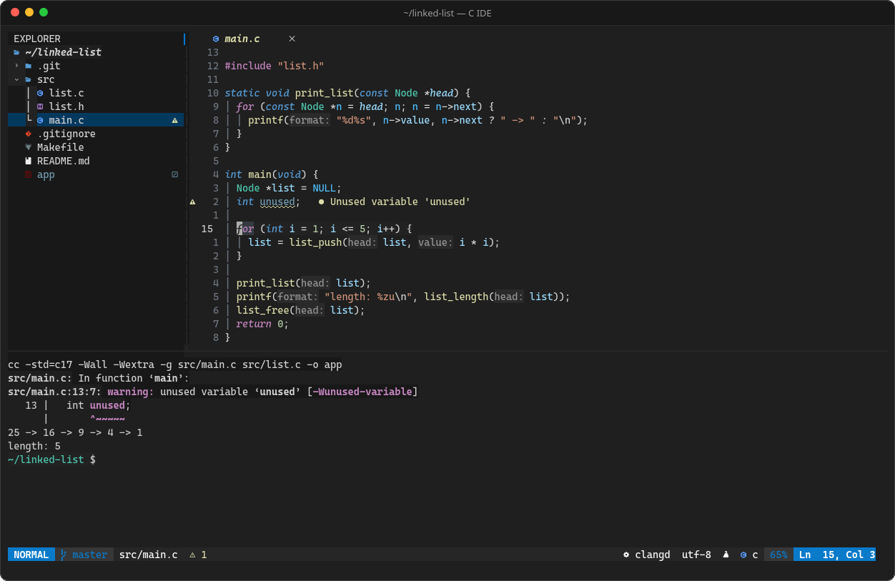

# c-ide

A keyboard-first C IDE that runs in the terminal. It is built on Neovim and themed after VS Code's **Dark Modern**.
It is meant to be driven entirely from the keyboard, though the mouse also works.



<sub>A small Makefile project: clangd flags an unused variable, `Ctrl+Alt+H` shows parameter names, and `F5` has built and run the program in the bottom terminal.</sub>

- File explorer, editor tabs, status bar and an integrated terminal, laid out like VS Code
- **clangd** for completion, diagnostics, go to definition, rename, formatting and .c/.h switching
- **F5** builds and runs the code. It detects CMake, then a Makefile, and otherwise compiles the single file with ASan/UBSan.
- **gdb** debugging (gdb's native DAP mode) with breakpoints, stepping, variables and watches
- VS Code shortcuts: `Ctrl+P`, `Ctrl+Shift+F`, `Ctrl+B`, `Ctrl+J`, `Ctrl+/`, `F12`, `F2`, `F9`/`F10`/`F11`
- Toggles: code coloring on/off (`F7`), and peeking parameter-name inlay hints (`Ctrl+Alt+H`)
- Markdown preview: rendered in the editor (`Ctrl+Shift+V`), or live in the browser with scroll sync (`Space m b`)
- Lightweight. With clangd running it uses about 115 MB of RAM in total, while VS Code with the same file uses about 1.2 GB.

## Requirements

- Neovim >= 0.11 (tested on 0.12)
- Node.js + npm (only for the browser markdown preview)
- `git`, `gcc`, `clangd`, `gdb` >= 14, `make`, `ripgrep`
- Optional: `foot` (dedicated window), `fd`, `lazygit`, `cmake` + `ninja`, `wl-clipboard`
- A Nerd Font, for example *Cascadia Mono NF*

On Fedora:

```sh
sudo dnf install neovim git gcc clang-tools-extra gdb make ripgrep fd-find lazygit foot cmake ninja-build wl-clipboard cascadia-mono-nf-fonts
```

## Install

```sh
./install.sh
```

The installer symlinks `nvim/` to `~/.config/nvim` and `bin/cide` to `~/.local/bin/cide`, and creates a
"C IDE" entry in the app menu. If a `~/.config/nvim` already exists, it is backed up before the link is made.
Because the files are symlinked, any edit to this repo takes effect the next time Neovim starts.

To undo the installation, run `./uninstall.sh`.

## Usage

```sh
cide                 # open the current directory in this terminal
cide path/to/project
cide -w path/to/file.c   # open in a dedicated foot window (full key support)
```

The dedicated window is useful because some terminals cannot tell certain keys apart (`Ctrl+Shift+F`, `Ctrl+Alt+H`, ...).
foot supports the kitty keyboard protocol, so every shortcut works there. Every shortcut also has a `Space ...`
alternative that works in any terminal.

Inside the editor:

- `Space` (then wait) lists every command
- `Space h` opens the cheat sheet ([nvim/CHEATSHEET.md](nvim/CHEATSHEET.md))
- `:Tutor` is the interactive Vim tutorial, worth doing once

## Layout

```
bin/cide                  launcher script
desktop/cide.desktop.in   app menu entry template
foot/foot.ini             dedicated terminal window (Dark Modern palette)
nvim/
  init.lua                entry point, bootstraps lazy.nvim
  lazy-lock.json          pinned plugin versions
  CHEATSHEET.md
  lua/cide/
    options.lua           editor options (mirrors the VS Code settings)
    keymaps.lua           global shortcuts
    autocmds.lua          auto save, treesitter, misc
    runner.lua            build / run / debug-build logic
    toggles.lua           syntax coloring and inlay hint toggles
    plugins/
      ui.lua              theme, explorer, tabs, status line, which-key
      editor.lua          telescope, terminal, git, problems panel, editing helpers
      lsp.lua             clangd + completion
      debug.lua           nvim-dap + gdb
      markdown.lua        in-editor and browser markdown preview
```

## Build & run rules (F5)

| Project has      | F5 does                                                                 |
|------------------|-------------------------------------------------------------------------|
| `CMakeLists.txt` | configures `build/` (Ninja, Debug), builds it, runs the newest executable |
| `Makefile`       | runs `make`, then `make run` if that target exists                       |
| neither          | `gcc -std=c17 -Wall -Wextra -g -fsanitize=address,undefined` → `./build/<name>`, then runs it |

The debugger (F6) uses the same rules but leaves out the sanitizers. For projects, it asks which executable
to debug and suggests the newest one.

## Known limitations

- A terminal cannot report a held modifier key on its own. VS Code shows parameter names while Ctrl+Alt is held;
  here they appear when you press `Ctrl+Alt+H` and disappear on the next cursor move.
- When debugging, a program that reads from stdin (`scanf`) cannot take input from the debugger UI.
  Use F5 for interactive programs.
- GNOME terminals use F11 for fullscreen. Use `Space d i` to step into instead.

## Keyboard reference

This is the same cheat sheet that opens inside the editor with `Space h`.
Here `Space` is the leader key: press it and wait, and a menu lists every command.

### VS Code style
| Key                  | Action                                  |
|----------------------|-----------------------------------------|
| Ctrl+S               | Save all (auto save is also on)         |
| Ctrl+P               | Go to file                              |
| Ctrl+Shift+F         | Search in all files  (also Space f g)   |
| Ctrl+F               | Find in current file (also /)           |
| F1 / Ctrl+Shift+P    | Command palette                         |
| Ctrl+B               | Toggle explorer      (Space e = focus)  |
| Ctrl+J / Ctrl+`      | Toggle terminal                         |
| Ctrl+/               | Toggle comment                          |
| Alt+Up / Alt+Down    | Move line                               |
| Shift+Alt+Down       | Duplicate line                          |
| Shift+Alt+F          | Format document                         |
| Ctrl+Shift+M         | Problems panel       (also Space x x)   |
| F8 / Shift+F8        | Next / previous problem                 |
| Ctrl+\               | Split editor right                      |
| Shift+L / Shift+H    | Next / previous tab (Ctrl+PgDn/PgUp)    |
| Space 1..5           | Go to tab N                             |
| Space q              | Close tab                               |
| Ctrl+Q / Space Q     | Quit the IDE (asks first)               |

### Code (clangd)
| Key            | Action                                   |
|----------------|------------------------------------------|
| F12 / gd       | Go to definition                         |
| Shift+F12 / gr | Find references                          |
| K              | Hover docs                               |
| F2             | Rename symbol                            |
| Ctrl+.         | Quick fix / code action                  |
| Alt+O          | Switch .c <-> .h                         |
| Ctrl+Space     | Trigger completion                       |
| Tab / Enter    | Accept completion                        |
| Ctrl+O / Ctrl+I| Jump back / forward                      |
| Ctrl+Alt+H     | Peek parameter names (hidden on next move)|
| Space u h      | Inlay hints on/off (permanent)           |

### Toggles
| Key            | Action                                   |
|----------------|------------------------------------------|
| F7 / Space u c | Code coloring on/off                     |
| Space u w      | Word wrap on/off                         |
| Space u n      | Relative line numbers on/off             |

### Markdown (.md files)
| Key                       | Action                                    |
|---------------------------|-------------------------------------------|
| Ctrl+Shift+V / Space m p  | Rendered preview in the editor on/off     |
| Space m b                 | Live preview in the browser (scroll sync) |

### Build, run, debug
| Key          | Action                                            |
|--------------|---------------------------------------------------|
| F5 / Space r | Build & run (CMake > Makefile > single file)      |
| Space R      | Build only                                        |
| F6 / Space dd| Start debugging / continue                        |
| F9 / Space db| Toggle breakpoint                                 |
| F10 / Space dn| Step over                                        |
| F11 / Space di| Step into (F11 may be fullscreen in the terminal)|
| Shift+F11 / Space do | Step out                                  |
| Shift+F5 / Space dq  | Stop                                      |
| Space de     | Evaluate expression under cursor                  |

Single files are built with `gcc -std=c17 -Wall -Wextra -g -fsanitize=address,undefined`
into `./build/<name>`. A Makefile `run:` target is used if it exists.

### Moving without the mouse (the Vim essentials)
| Key              | Action                                       |
|------------------|----------------------------------------------|
| i / a / o / O    | Insert before / after cursor, new line below / above |
| Esc              | Back to normal mode                          |
| h j k l          | Left / down / up / right                     |
| w / b / e        | Next word / previous word / end of word      |
| 0 / ^ / $        | Line start / first char / line end           |
| gg / G / 42G     | File start / end / line 42                   |
| 5j / 12k         | 5 lines down / 12 up (see relative numbers)  |
| { / }            | Previous / next paragraph (block)            |
| %                | Jump to matching bracket                     |
| s + 2 letters    | Jump anywhere on screen (flash)              |
| Ctrl+D / Ctrl+U  | Half page down / up                          |
| dd / yy / p      | Delete (cut) line / copy line / paste        |
| ciw / ci( / ci"  | Change word / inside parens / inside quotes  |
| u / Ctrl+R       | Undo / redo                                  |
| v / V            | Select characters / lines                    |
| .                | Repeat last change                           |
| * / n / N        | Search word under cursor / next / previous   |

### Windows & terminal
| Key            | Action                                     |
|----------------|--------------------------------------------|
| Alt+h/j/k/l    | Move between explorer / editor / terminal  |
| Esc Esc        | Leave terminal typing mode                 |
| Space t f      | Floating terminal                          |
| Space g g      | Lazygit                                    |

### Explorer (when focused)
`a` new file (end with / for a folder), `d` delete, `r` rename, `c`/`m` copy/move,
`l`/Enter open, `h` close folder, `H` hidden files, `?` help.

`:q`, `ZZ` or `Ctrl+W q` on the last file closes the file, not the IDE.
If the IDE ever closes unexpectedly, the last keys pressed are in
`~/.local/state/nvim/cide-last-keys.log`.

Press **Space** and wait to see every leader shortcut. `Space ?` lists all keys.
New to Vim? Run `:Tutor` once (≈30 min) — it pays off fast.

## License

[MIT](LICENSE)
